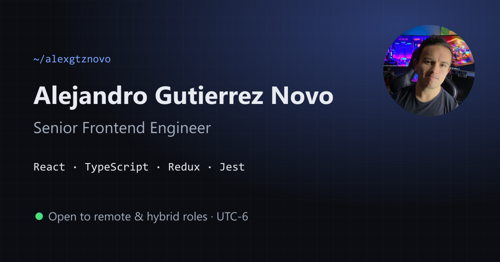

# Alejandro Gutierrez Novo — Portfolio

[](https://github.com/alexgn0110/WebPortafolioAGN/actions/workflows/ci.yml)

Personal site of a Senior Frontend Engineer (React · TypeScript · Redux · Jest), based in Monterrey, Mexico (UTC-6).

**Live:** https://alexgn0110.github.io/WebPortafolioAGN/



## Stack

- **React 19** + **TypeScript** in strict mode (`noUncheckedIndexedAccess`, `exactOptionalPropertyTypes`)
- **Vite 7** for dev server and production builds
- **CSS Modules** on top of a small token-based design system (light and dark themes)
- **Vitest** + **React Testing Library** for behaviour-focused tests
- **ESLint** (typescript-eslint strict, react-hooks, jsx-a11y) and **Prettier**
- **GitHub Actions** CI: lint → typecheck → format check → tests → build on every push

## Details worth a look

| Area            | What it does                                                                                                                                                                                          |
| --------------- | ----------------------------------------------------------------------------------------------------------------------------------------------------------------------------------------------------- |
| Accessibility   | Skip link, labelled landmarks, visible `:focus-visible` rings, `aria-current` on the active nav item, screen-reader text for external links, `prefers-reduced-motion` respected everywhere            |
| Command palette | <kbd>⌘K</kbd> / <kbd>Ctrl K</kbd> opens an ARIA combobox: multi-term filtering, arrow-key navigation via `aria-activedescendant`, focus restoration, scroll lock                                      |
| Theming         | Saved or system theme applied by an inline script **before first paint** (no flash), persisted in `localStorage`, `theme-color` meta kept in sync                                                     |
| Performance     | Self-hosted variable fonts, WebP images with explicit dimensions (no layout shift), lazy-loaded below-the-fold media, the email SDK loaded only on submit, React split into its own long-cached chunk |
| SEO             | Meta description, canonical URL, Open Graph / Twitter card, JSON-LD `Person` schema, `robots.txt` and `sitemap.xml`                                                                                   |
| Content         | Every section renders from one typed file, [`src/data/profile.ts`](src/data/profile.ts), so the site and the CV stay in sync                                                                          |
| Contact form    | Accessible labels, loading / success / error states announced through an `aria-live` region, honeypot spam protection                                                                                 |

## Scripts

```bash
npm install
npm run dev            # local dev server
npm test               # run the test suite
npm run lint           # ESLint
npm run typecheck      # TypeScript
npm run build          # production build into dist/
npm run deploy         # build and publish dist/ to GitHub Pages (gh-pages branch)
```

Requires Node.js 20.19+ (see `.nvmrc`).

## Project structure

```
src/
├── App.tsx                 # layout, ⌘K shortcut and command list
├── data/profile.ts         # all content (experience, skills, projects)
├── components/             # one folder per section, each with its CSS Module
├── hooks/                  # useTheme, useActiveSection, useLocalTime, useReveal
├── lib/                    # small helpers and config
├── styles/global.css       # design tokens, reset and shared primitives
└── test/setup.ts           # Vitest + jsdom setup
```

## Contact

alex_guno0110@hotmail.com · [LinkedIn](https://www.linkedin.com/in/alexgtznovo/) · [GitHub](https://github.com/alexgn0110)
